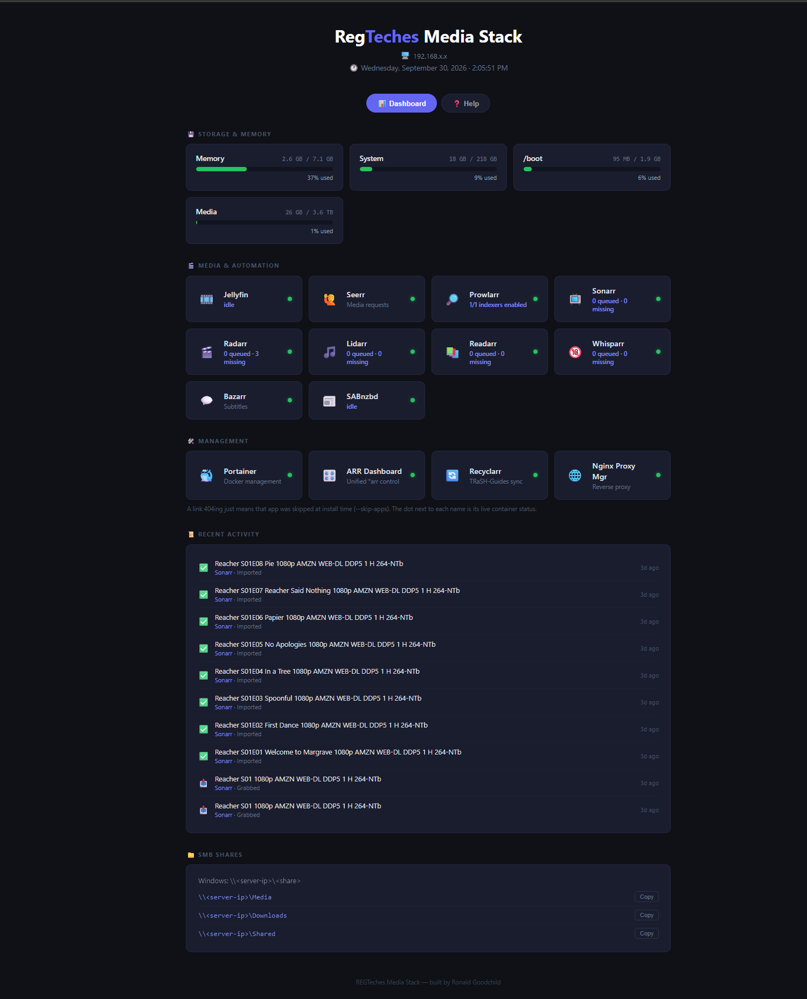

# REGTeches Media Stack — Ubuntu Server

Developed by Ronald Goodchild for your pleasure.

A Docker Compose install for Ubuntu Server (24.04/26.04 LTS) of Prowlarr,
Sonarr, Radarr, Lidarr, Readarr, Whisparr, Bazarr, SABnzbd, qBittorrent (routed through
a Mullvad WireGuard VPN kill switch), Jellyfin (with Intro Skipper, Playback
Reporting, Fanart, TheTVDB, and Webhook plugins), Seerr (request management),
Recyclarr (automatic TRaSH-Guides sync), arr-dashboard (a unified control
panel across every *arr app), Portainer, Watchtower, and Nginx Proxy
Manager, plus Samba shares and a branded status dashboard. The
Windows sibling of this project is [media-stack-installer](https://github.com/ronaldgoodchild/media-stack-installer) — that
one is native/NSSM-service based (no Docker) because that's the sane way to
do it on Windows; this one is Docker Compose because that's the sane way to
do it on Linux.



## Quick start

```bash
git clone https://github.com/ronaldgoodchild/media-stack-ubuntu.git
cd media-stack-ubuntu
sudo ./install.sh
```

Run from an elevated (`sudo`) shell. It'll interactively ask for your
Mullvad WireGuard key (for the qBittorrent VPN kill switch — leave blank to
skip qBittorrent entirely) and a Samba password, then does everything else
unattended.

**Command line (technician / unattended):**

```bash
sudo ./install.sh \
  --mullvad-private-key "abcd..." \
  --mullvad-address "10.x.x.x/32" \
  --smb-password "yourpassword" \
  --non-interactive
```

Useful flags:

| Flag | Effect |
|---|---|
| `--install-root PATH` | Where the compose file/.env live (default `/opt/mediastack`) |
| `--media-root PATH` | Where media/downloads/appdata live (default `/mnt/media`) |
| `--stack-user NAME` | System user that owns everything + runs Samba (default: whoever ran `sudo`) |
| `--timezone TZ` | Container timezone (default `America/New_York`) |
| `--skip-apps LIST` | Comma list to leave out: `qbittorrent,sabnzbd,bazarr,lidarr,readarr,whisparr,seerr,recyclarr,arr-dashboard,npm` (skipping `qbittorrent` also skips the `gluetun` VPN container) |
| `--mullvad-private-key` / `--mullvad-address` | Your Mullvad WireGuard config (from your Mullvad account page) |
| `--vpn-country COUNTRY` | Mullvad server country (default `USA`) |
| `--smb-user` / `--smb-password` | Samba share login (defaults to `--stack-user`) |
| `--skip-samba` | Don't configure Samba shares |
| `--skip-firewall` | Don't touch `ufw` |
| `--skip-tailscale` | Don't install Tailscale |
| `--tailscale-authkey KEY` | Join your tailnet unattended (from your Tailscale admin console → Settings → Keys); omit to approve it yourself in a browser after install |
| `--force-env` | Overwrite an existing `.env` instead of leaving it alone |
| `--non-interactive` | Fail instead of prompting when something required is missing |

The script is **idempotent** — safe to re-run any time. It won't overwrite an
existing `.env` (so it won't clobber your Mullvad key/API keys) unless you
pass `--force-env`, and every other step checks current state first.

## What the installer actually does

1. Installs Docker + the Compose plugin (skipped if already present).
2. Creates the directory tree under `--media-root` (`Media/{Movies,TV,Music,Books,Adult}`,
   `Downloads/{incomplete,complete}`, `AppData/<app>`, `Shared`), owned by
   the stack user.
3. Copies `docker-compose.yml` and `dashboard/` from this repo into
   `--install-root` and writes `.env` (PUID/PGID, timezone, media root,
   Mullvad credentials, and which optional apps are enabled).
4. Brings the whole stack up with `docker compose up -d`, gated by Compose
   **profiles** — every optional app (`qbittorrent`, `sabnzbd`, `bazarr`,
   `lidarr`, `whisparr`, `seerr`, `recyclarr`, `arr-dashboard`, `npm`) is its
   own profile, toggled by `COMPOSE_PROFILES` in `.env`. Core apps (Jellyfin,
   Prowlarr, Sonarr, Radarr, Portainer, Watchtower, the dashboard) always run.
5. Routes qBittorrent's entire network namespace through **Gluetun**
   (Mullvad WireGuard) — if the VPN drops, qBittorrent loses internet
   instead of leaking your real IP to the swarm. SABnzbd talks Usenet
   directly since that protocol has no IP-exposure concern. (There's
   deliberately only one Usenet client — SABnzbd and NZBGet do the same job,
   and running both just means twice the setup for no benefit.)
6. Registers a `mediastack.service` systemd unit
   (`Requires=docker.service`, `WantedBy=multi-user.target`) so
   `docker compose up -d` runs on every boot, same idea as NSSM on the
   Windows side.
7. Configures Samba (`[Media]`, `[Downloads]`, `[Shared]`) so the same
   library is reachable from Windows machines on your LAN — unless
   `--skip-samba`.
8. Opens the right ports on `ufw`, scoped to whichever optional apps you
   actually enabled — unless `--skip-firewall`.
9. Builds a branded dashboard at **http://<server-ip>:8090** — a static
   launcher page (served by a tiny `nginx:alpine` container) with a link to
   every app, plus the SMB share paths with a copy button, plus a **Storage**
   panel: a gauge per mounted filesystem (green/amber/red at 75%/90%,
   same thresholds as the Windows dashboard), a **Memory** gauge, and a live
   green/amber/red status dot on every app card — all fed by
   `tools/update-stats.sh` on a 30-second systemd timer
   (`mediastack-stats.timer`) that writes `dashboard/stats.json` from `df`,
   `free`, and `docker compose ps` — no separate API/backend needed. A
   second tab, **Help**, is a plain-English walkthrough for someone who's
   never seen this stack before: what to click first, what every app does,
   the shared logins, and how to map the SMB shares — written for the
   person using the box, not the person who set it up.
10. Installs **Tailscale** so the box is reachable from elsewhere without
    port-forwarding — see the Tailscale section below.
11. Prints a summary at the end with every enabled app's URL.

**No Recyclarr sync, no Jellyfin/Seerr first-run-wizard automation** —
unlike the Windows installer, this one stops at "the stack is up and every
app's web UI is reachable." Sonarr/Radarr's root folders and download
clients, and Jellyfin's setup wizard, are still a few clicks each; the *arr
apps auto-discover each other once you add them all inside Prowlarr
(Settings → Apps).

**Indexers are up to you.** Prowlarr is installed with no indexers; add the ones you
have accounts with or are entitled to use, then the wiring step below syncs them out to
every *arr app.

**Nor is the rest of the wiring** — root folders, download clients,
Prowlarr↔*arr app registration, Bazarr↔Sonarr/Radarr, per-app login. Run
once the stack is up:

```bash
python3 tools/wire-stack.py
```

Sets forms authentication (username `media`; a **random password is generated on first run**,
printed at the end and saved to `credentials.txt` — or pass `--username`/`--password`) on Sonarr, Radarr, Lidarr, Readarr, Whisparr, and Bazarr; adds each
app's root folder on the media drive; registers SABnzbd as a
download client (with matching categories) in Sonarr/Radarr/Lidarr/Whisparr;
registers those four apps as Prowlarr **Applications** so every indexer
you add in Prowlarr syncs out automatically; connects Bazarr to Sonarr and
Radarr. Idempotent — safe to
re-run after changing anything.

**What it deliberately leaves for you:**
- **Indexer and Usenet-provider accounts.** These are your own third-party
  logins; add them in Prowlarr and SABnzbd yourself.
- **Portainer's, NPM's, and arr-dashboard's admin passwords.** All three
  enforce a complexity/length minimum the shared app login may not meet (Portainer:
  12+ chars; NPM: 8+ chars; arr-dashboard: 8+ chars with upper/lower/
  number/special), so none were set automatically. Pick a compliant
  password for these specifically: Portainer prompts for one on first
  visit to `:9000` (grab the one-time setup token with
  `docker logs portainer | grep setup_token`, since it printed before you
  had a chance to use it); NPM prompts for one on first visit to `:81`;
  arr-dashboard prompts for one on first visit to `:3050`.

## Requests, TRaSH-Guides sync, and unified control

Three more apps round out the stack, each set up through its own first-run
web wizard rather than scripted (there's no API to drive until you've
clicked through each one at least once):

- **Seerr** (`:5055`) — movie/TV request management tied to Jellyfin. Not
  Jellyseerr: [Jellyseerr hasn't had a real release in about a year and
  can't authenticate against Jellyfin 12.x's new auth
  API](https://github.com/binhex/arch-jellyfin/issues/11) — Seerr is the
  actively-maintained continuation, same app the Windows
  installer uses. Sign in with your Jellyfin login,
  point it at `http://jellyfin:8096`, sync your libraries, and add
  `http://radarr:7878` / `http://sonarr:8989` with their API keys (from
  each app's `config.xml`) as the request targets — pick the TRaSH-Guides
  quality profile `recyclarr` already created (`HD Bluray + WEB` /
  `WEB-1080p`) so requests land at the same quality as everything else.
- **Recyclarr** (no web UI) — syncs TRaSH-Guides custom formats and
  quality profiles into Sonarr/Radarr on a daily cron
  (`CRON_SCHEDULE=0 6 * * *` in `docker-compose.yml`). Config lives at
  `AppData/recyclarr/configs/*.yml`; scaffold more with
  `docker compose exec recyclarr recyclarr config create --template <id> -p /config/configs`
  (`docker compose exec recyclarr recyclarr config list templates` to see
  what's available), fill in `base_url`/`api_key`, then
  `docker compose exec recyclarr recyclarr sync` to run it immediately
  instead of waiting for the next 6am.
- **arr-dashboard** (`:3050`) — a unified control panel across every *arr
  app: search, calendar, download queue, and requests from one page
  instead of switching between Sonarr/Radarr/Prowlarr's own UIs. Sign in
  with a compliant password (see above), then add each app under
  Settings using their internal hostnames (`http://sonarr:8989`, etc.)
  and API keys.

## Jellyfin plugins

`install.sh` doesn't install these — Jellyfin's plugin catalog isn't
reachable until the server (and its admin account) already exist. Added
once, by hand, via the official catalog plus one custom repository:

| Plugin | Why |
|---|---|
| **Intro Skipper** | The single most-installed Jellyfin plugin — detects and adds a "Skip Intro"/"Skip Credits" button per episode. Needs its own repository (not in the default catalog): `https://intro-skipper.org/manifest.json`, added under Dashboard → Plugins → Repositories. |
| **Playback Reporting** | Watch-history stats and an activity dashboard. |
| **Fanart** | Extra backdrop/artwork from fanart.tv. |
| **TheTVDB** | A second TV metadata source alongside the built-in TMDb. |
| **Webhook** | Fires HTTP calls on playback/library events — wire it to anything that takes a webhook. |

Trakt and TMDb account-linking were deliberately skipped — both need you
to authorize a third-party account, which is yours to do from Dashboard →
Plugins if you want it, not something to automate here.

## Tailscale

`install.sh` installs the Tailscale client automatically (skip with
`--skip-tailscale`). Joining a tailnet needs a real account login, so it's
the one step that can't be fully unattended unless you pass
`--tailscale-authkey` (from your Tailscale admin console → Settings →
Keys) — without one, the installer prints a login link at the end for you
to open and approve. **Decide first whose tailnet it should join** — if
this box is heading to someone else eventually, joining your own tailnet
now means you can reach their server indefinitely; consider waiting and
letting them join it with their own account once it's theirs.

Once joined, the whole stack is reachable over Tailscale's IP the same way
it is over the LAN IP — every app, the dashboard, SMB — no port-forwarding,
no exposing anything to the raw internet.

**Whoever ends up owning this box doesn't need SSH commands to find the
join link** — `install.sh` also drops `/etc/update-motd.d/99-tailscale-setup`,
which prints the current login link on every SSH login for as long as the
box is unjoined, and self-clears (stops printing, nothing to remove by
hand) the moment it actually connects. Handy for a handoff scenario: give
them SSH access, they see exactly what to do the first time they log in,
and the reminder disappears on its own once it's done.

**Remote support without merging networks**: once the box is on *its
owner's* tailnet, Tailscale's own **Sharing** feature (Tailscale admin
console → that device → **Share**) lets them grant access to one specific
person's tailnet — quarantined to just that device, nothing else on their
network, revocable anytime by either side. That's the intended way to give
someone (e.g. whoever set the box up) ongoing remote-support access
without adding them to the owner's whole tailnet.

## Offline alerts (ntfy.sh)

`install.sh` generates a random, unguessable [ntfy.sh](https://ntfy.sh)
topic (skip with `--skip-ntfy`, or bring your own with `--ntfy-topic NAME`)
and stores it in `.env` as `NTFY_TOPIC`. From then on, `update-stats.sh`
compares each app's status to its previous run on every 30-second tick and
fires a push notification — sound + vibration on the ntfy app, or just
watch `https://ntfy.sh/<topic>` in a browser — the moment something
**transitions**:

- Was up, now down → urgent-priority alert.
- Was down, now back up → normal-priority recovery notice.

Deliberately **not** on every poll while something's still down (that
would spam a notification every 30 seconds) and **not** on the very first
run after install (nothing to compare against yet, so it seeds a silent
baseline instead of firing false alarms for anything already-known-off,
like a deliberately-skipped qBittorrent). Tested live end-to-end while
building this — stopping and restarting a container produces exactly the
two expected notifications and nothing else.

The topic name is shown on the dashboard's Help tab and in the install
summary. **Treat it like a password** — ntfy.sh's public server has no
authentication by default, so anyone who knows the exact topic name can
read (or post to) it too.

## Live dashboard stats

Every app card on the Dashboard tab shows a live one-line stat in place of
its static description, whenever `collect-services.py` (called by
`update-stats.sh` every 30s) knows how to read that app's API:

- **Sonarr / Radarr / Lidarr / Readarr / Whisparr** — "`N queued · N missing`"
  (queue size and missing-wanted count).
- **Prowlarr** — "`N/N indexers enabled`".
- **SABnzbd** — "`N active · N.N MB/s`", or "`idle`" when the queue's empty.
- **Jellyfin** — "`N streaming`", or "`idle`" when nothing's playing.

All of these except Jellyfin work with zero setup — each app's own API key
is read straight off its config on disk, same as `wire-stack.py` already
does. **Jellyfin is the one exception**: it needs an API key in `.env`,
and that can't be generated automatically because Jellyfin's first-run
setup wizard (create the admin account) has to be done by hand first, same
as your Usenet provider's login. Once you've finished that wizard:

1. Jellyfin → Dashboard → API Keys → **+**, name it anything (e.g.
   `dashboard-stats`).
2. Copy the generated key into `.env` as `JELLYFIN_API_KEY=<key>` (see
   `.env.example`).

No restart needed — `update-stats.sh` re-reads `.env` on every 30-second
tick, so the Jellyfin card picks up its live stat within half a minute.
Leave `JELLYFIN_API_KEY` blank and the card just keeps its static
description instead — nothing breaks.

Below the Storage & Memory panel, **Recent Activity** shows the last 20
grabs/imports across Sonarr/Radarr/Lidarr/Readarr/Whisparr, merged and
sorted newest-first, straight from each app's own history — no setup
needed, and it's empty (with a placeholder message) until the first thing
actually gets grabbed.

One auth quirk worth knowing if you ever query Jellyfin's API by hand:
newer Jellyfin rejects the older `X-Emby-Token: <key>` header on
`/Sessions` with a 401 — use `Authorization: MediaBrowser Token="<key>"`
instead (confirmed live against this stack; `collect-services.py` already
uses the working format).

## First-visit onboarding (port 80)

Someone opening this box for the first time won't know to add `:8090` to
the address — they'll just type the IP. Nginx Proxy Manager already owns
port 80, so point its **default site** (what it shows for a request that
doesn't match any configured host, which a bare IP always is) at the
dashboard instead of NPM's own placeholder page:

1. Log into NPM (`:81`) → **Settings** → **Default Site** → **Custom HTML**.
2. Paste:
   ```html
   <!DOCTYPE html>
   <html><head>
   <meta charset="UTF-8">
   <title>REGTeches Media Stack</title>
   <script>window.location.replace('http://' + window.location.hostname + ':8090/');</script>
   </head><body></body></html>
   ```
3. Save.

That's a JS redirect that reads whatever address the browser actually used
to get there, so it keeps working after the box moves to a different
network — unlike NPM's built-in "Redirect" option, which needs a fixed URL
and would silently break. Not automated in `install.sh` because it needs
NPM's own admin account, which (like Portainer's and arr-dashboard's)
only exists after its first-run web wizard.

## Right-click an app card → Manage in Portainer

Every app card on the Dashboard tab is right-clickable — it opens a small
menu with **Manage in Portainer**, which deep-links straight to that
specific container's page in Portainer (Start/Stop/Restart/Logs/Console,
all already built and safe — rather than reinventing container control
inside the dashboard itself). Deliberately **not** an invisible one-click
auto-login: Portainer's API doesn't send CORS headers for cross-origin
requests, so a browser will not let a page on `:8090` silently complete a
login to a page on `:9000` — that's the browser's own security model, not
something fixable from a static file. Instead, `Settings → General → User
session timeout` (Portainer) is set to `8760h` (1 year) during setup, so
logging in once keeps that browser signed in essentially indefinitely —
the deep link then lands you already authenticated on every subsequent
right-click.

The container IDs behind these links come from `stats.json` (same
30-second timer as the status dots), not a hardcoded list — Watchtower
recreates containers (new IDs) whenever it auto-updates one, so a stale
hardcoded ID would silently break within a day or two.

## Day-to-day operation

| Task | How |
|---|---|
| Open any app | Dashboard at `http://<server-ip>:8090` |
| Check status | `docker compose -f /opt/mediastack/docker-compose.yml ps` |
| View logs | `docker compose -f /opt/mediastack/docker-compose.yml logs -f <service>` |
| Restart one app | `docker compose -f /opt/mediastack/docker-compose.yml restart sonarr` |
| Pull newer images now | `sudo ./update.sh` (Watchtower also does this automatically once a day) |
| Uninstall (keep data) | `sudo ./uninstall.sh` |
| Uninstall + delete stack config | `sudo ./uninstall.sh --purge-data` |
| Uninstall + delete your media too | `sudo ./uninstall.sh --purge-data --purge-media` (separate flag on purpose — this deletes your actual library) |

## Ports

| App | Port |
|---|---|
| Dashboard | 8090 |
| Portainer | 9000 / 9443 |
| Jellyfin | 8096 |
| Prowlarr | 9696 |
| Sonarr | 8989 |
| Radarr | 7878 |
| Lidarr | 8686 |
| Readarr | 8787 |
| Whisparr | 6969 |
| Bazarr | 6767 |
| qBittorrent | 8088 (via Gluetun) |
| SABnzbd | 8085 |
| Seerr | 5055 |
| arr-dashboard | 3050 |
| Nginx Proxy Manager | 80 / 81 (admin) / 443 |
| Samba | 137/udp, 138/udp, 139/tcp, 445/tcp |

## Folder layout

```
<install-root>/            default: /opt/mediastack
  docker-compose.yml
  .env                      PUID/PGID, TZ, media root, Mullvad creds, enabled profiles
  dashboard/                index.html served at :8090

<media-root>/               default: /mnt/media
  Media/{Movies,TV,Music,Books,Adult}/
  Downloads/{incomplete,complete}/
  AppData/<app>/            each app's config/database
  Shared/
```

**`.env` is sensitive** — it holds your Mullvad WireGuard private key and
(if Samba isn't skipped) is adjacent to your Samba password prompt history.
It's `chmod 600`, owned by root; don't commit it, don't share it.

## VPN note

If `MULLVAD_PRIVATE_KEY` is blank, `qbittorrent` (and `gluetun`) are simply
left out of `COMPOSE_PROFILES` — the rest of the stack runs fine without a
torrent client, using Usenet (SABnzbd) only. Add a key later and
re-run `sudo ./install.sh --force-env` to turn qBittorrent on.

## A note on Readarr

Readarr's upstream project is archived — there's no "stable" release
anymore, only a pre-release "develop" build (`linuxserver/readarr:develop`;
confirmed no `latest` tag exists and nothing's been published since mid-2025).
It works, but expect it to be the least polished piece of the stack — same
caveat as the Windows installer's Readarr.

## Known gaps / what's not built yet

- No tray app / native client — this is a headless server stack, managed
  through each app's own web UI plus Portainer.
- No public-indexer auto-population, no Recyclarr/TRaSH-Guides sync, no
  Jellyfin/Seerr setup-wizard automation — see the note above.
- Dashboard is a static launcher (like the Windows repo's `website/`
  marketing page), not the Windows dashboard's live-polling status tiles.

## Legal

You're responsible for what you point these apps at and for complying with
your indexers' terms and your local laws. This stack automates library
organization; it doesn't include or access any content itself.

## Security notes

- `credentials.txt` (created by `tools/wire-stack.py`) and `.env` hold logins and keys in plain text. Keep the install folder private; both are git-ignored.
- Expose services to the internet only through a VPN such as Tailscale, never by port-forwarding.
- Report security problems privately through the repository's Security tab.

## License

[MIT](LICENSE) (c) 2026 Ronald Goodchild / REGTeches
